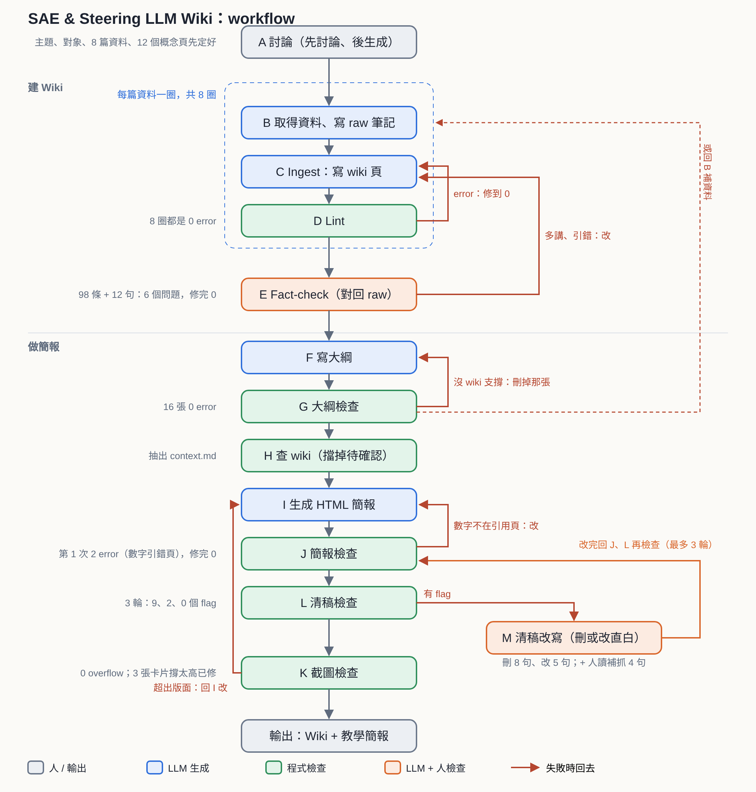

# LLM Wiki 教學簡報：SAE 與 Activation Steering

GenAI 課程作業：先用「先討論、後生成」建一個 LLM Wiki，再用它當知識來源做教學 HTML 簡報。

- 教學簡報：[slides/](https://ddd-dong.github.io/llm-wiki-sae-steering/slides/)
- Wiki 網頁版：[wiki.html](https://ddd-dong.github.io/llm-wiki-sae-steering/wiki.html)

## 繳交項目
| 項目 | 檔案 |
|---|---|
| 需求摘要 | [REQUIREMENTS.md](REQUIREMENTS.md) |
| AGENTS.md | [AGENTS.md](AGENTS.md) |
| workflow 流程圖 | [WORKFLOW.md](WORKFLOW.md)（圖：[workflow.png](workflow.png)） |
| 一次實際執行的檢查報告 | [CHECK_REPORT.md](CHECK_REPORT.md) |
| 討論紀錄 | [00_discussion.md](00_discussion.md) |



## 目錄
```
raw/        8 篇來源筆記
wiki/       index、12 個概念頁、8 個 source 頁、log
slides/     outline.md、context.md、index.html（簡報）
tools/      lint_wiki / check_outline / query_wiki / check_slides / clean_check / shoot / draw_workflow
runs/       每次檢查的原始輸出（runs/prev/ 是第一版 Prompt Injection）
```

## 重跑檢查
```
python3 tools/lint_wiki.py
python3 tools/check_outline.py
python3 tools/query_wiki.py
python3 tools/check_slides.py
python3 tools/clean_check.py
```
