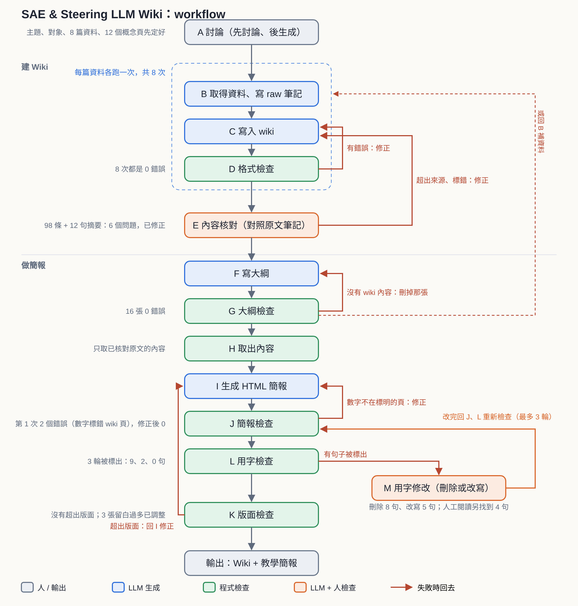

# Workflow 設計



## 節點

| # | 節點 | 做什麼 | 工具 | 通過條件 | 不通過時回到 |
|---|---|---|---|---|---|
| A | 討論 | 確定主題、對象、資料清單、概念頁清單 | 人 + LLM | 人確認後才往下 | A |
| B | 取得資料 | 搜尋並閱讀原文，寫成 raw/ 筆記 | 網路搜尋 | 有網址、日期，引文最多一句 | B |
| C | 寫入 wiki | 寫來源頁、更新概念頁、index、log | LLM + addfact.py | | |
| D | 格式檢查 | 連結是否有效、每條事實是否標來源、數字能否在 raw/ 找到、有沒有頁面沒被連到、index 有沒有漏頁 | lint_wiki.py | 0 個錯誤 | C |
| E | 內容核對 | 每條事實和每頁的一句話摘要，逐條對照 raw/，找出來源沒有的說法 | LLM + 人工 | 沒有來源不支持的說法 | C |
| F | 寫大綱 | 每張投影片寫一個要回答的問題，並列出用到的 wiki 頁 | LLM | | |
| G | 大綱檢查 | 每張投影片都有對應的 wiki 頁、每個概念頁都有被用到 | check_outline.py | 0 個錯誤 | F（刪掉那張）或 B（補資料） |
| H | 取出內容 | 依大綱從 wiki 取出每張要用的內容，尚未核對原文的內容不取 | query_wiki.py | | |
| I | 生成簡報 | 用 H 取出的內容寫 HTML，每張標明用到的 wiki 頁 | LLM | | |
| J | 簡報檢查 | 標明的 wiki 頁是否存在、投影片上的數字是否在那些頁裡、術語第一次出現有沒有解釋 | check_slides.py | 0 個錯誤 | I（只改出錯的那張） |
| L | 用字檢查 | 找出投影片上的製作流程說明，以及制式化的 AI 句型 | clean_check.py | 0 句被標出 | M |
| M | 用字修改 | 被標出的句子：刪掉不影響教學就刪除，否則改寫得更直白；再人工讀一遍，找程式沒抓到的 | LLM + 人工 | 改完回 J、L 重新檢查 | J |
| K | 版面檢查 | 每張截圖，檢查內容有沒有超出版面 | shoot.py | 沒有超出版面 | I |

## 流程

```
A 討論
 |
 +-- 每篇資料各跑一次（共 8 次）
 |     B 取得資料
 |     C 寫入 wiki
 |     D 格式檢查 ---- 不通過 ---> C
 |
 E 內容核對 ---- 不通過 ---> C
 |
 F 寫大綱
 G 大綱檢查 ---- 不通過 ---> F（刪掉那張）或 B（補資料）
 H 取出內容（只取已核對原文的）
 I 生成簡報
 J 簡報檢查 ---- 不通過 ---> I
 L 用字檢查 ---- 有句子被標出 ---> M 用字修改 ---> 回 J、L（最多 3 輪）
 K 版面檢查 ---- 不通過 ---> I
```

## 哪些步驟會重複
- B、C、D 每篇資料各跑一次，共 8 次。一次只寫入一篇，D 通過才處理下一篇，錯誤才不會累積。
- D、J 不通過時，回到前一個生成步驟，只修改出錯的頁面或那一張投影片。
- L、M 是一個小迴圈：改寫可能會改到數字，所以每輪改完都要回 J 再檢查一次，最多 3 輪，3 輪後還有問題就交給人處理。
- 尚未核對原文的內容在 H 就被排除。要放進簡報，就要先回 B 查原文確認；查不到就不放。

## 為什麼這樣設計
- 能用程式檢查的（連結、數字、格式）就用程式，成本低又穩定，每一輪都跑。
- 程式判斷不了的（加了來源沒有的詮釋、來源標錯），在 wiki 完成後、做簡報前，由 LLM 和人工核對一次。
- 「有沒有 wiki 內容支持」在大綱階段就檢查，避免 HTML 生成完才發現某張投影片沒有資料依據。
- 生成簡報以 H 取出的內容為準，再由 J 檢查數字有沒有超出標明的 wiki 頁，避免 LLM 自行補充內容。
- 投影片是給學生看的，不是給助教看製作流程的。來源標示只放在每張底部和 wiki 裡，投影片本體只放教學內容。
